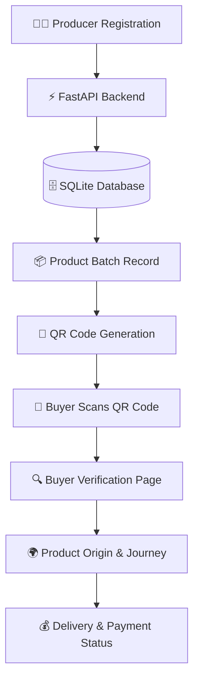

# 🌿 TrustTrail

## Blockchain-Verified Origin for Every Himalayan Farm & Artisan Product

TrustTrail is a product-origin verification platform designed to help customers verify the authenticity and origin of Himalayan farm and artisan products such as honey, apples, saffron, and pashmina.

The platform connects **producers and buyers through a transparent digital product journey**, allowing buyers to verify product information using a QR code.

> 🚀 **Hackathon Prototype:** This version demonstrates the core TrustTrail workflow using Python, FastAPI, HTML, CSS, SQLite, and QR-code generation. Blockchain, IPFS, OTP authentication, maps, and real payment integration are planned for the production version.

---

## 🎯 Problem

Himalayan farm and artisan products can face problems such as:

* ❌ Fake or misleading product origins
* ❌ Lack of transparency for buyers
* ❌ Difficulty verifying authentic producers
* ❌ Limited visibility into the product journey
* ❌ Middlemen reducing producer earnings
* ❌ Delayed payments to producers

Customers need a simple way to know **where a product came from and whether its origin can be trusted.**

---

## 💡 Our Solution

TrustTrail provides a digital verification workflow:

**Producer → Product Batch → QR Code → Buyer Verification → Product Journey → Payment Status**

A producer registers their details and creates a product batch. TrustTrail generates a unique QR code for that batch.

When a buyer scans the QR code, they can view the registered product and producer information and follow the product's verification journey.

---

## ✨ Key Features

### 👨‍🌾 Producer Registration

Producers can register:

* Name
* Phone number
* Location

### 📦 Batch Registration

Producers can register product batches with:

* Product name
* Quantity
* Origin
* Product description

### 🔲 QR Code Generation

Each registered product batch receives a unique QR code linked to its verification page.

### 🔍 Product Verification

Buyers can open the QR-linked verification page to view:

* Producer information
* Product details
* Origin
* Verification status
* Product journey
* Payment status

### 💰 Delivery & Payment Simulation

The prototype includes a delivery action that changes the batch status to **PAID**, demonstrating the intended producer-payment workflow.

---

## 🏗️ System Architecture



---

## 🛠️ Technology Stack

| Technology  | Purpose                |
| ----------- | ---------------------- |
| **Python**  | Backend programming    |
| **FastAPI** | Backend web framework  |
| **Uvicorn** | ASGI server            |
| **SQLite**  | Prototype database     |
| **Jinja2**  | HTML templating        |
| **HTML5**   | Frontend structure     |
| **CSS3**    | User interface styling |
| **QRCode**  | QR-code generation     |
| **Pillow**  | Image processing       |

---

## 📸 Screenshots

Screenshots of the working TrustTrail prototype:

### 🏠 Home Page


### 👨‍🌾 Producer Registration


### 📦 Batch Registration


### 🔲 QR Code Generated


### ✅ Product Verification


---

## 📁 Project Structure

```text
TrustTrail/
│
├── main.py
├── database.py
├── requirements.txt
├── .gitignore
├── README.md
│
├── screenshots/
│   ├── home.png
│   ├── producer.png
│   ├── batch.png
│   ├── qr-success.png
│   └── verify.png
│
├── templates/
│   ├── index.html
│   ├── producer.html
│   ├── batch.html
│   ├── success.html
│   └── verify.html
│
└── static/
    └── style.css
```

> Generated QR images and the local SQLite database are excluded from Git using `.gitignore`.

---

## ⚙️ Installation & Setup

### 1. Clone the repository

```bash
git clone https://github.com/Bhavitha-sri/TrustTrail.git
```

### 2. Open the project

```bash
cd TrustTrail
```

### 3. Create a virtual environment

```bash
python -m venv venv
```

### 4. Activate the virtual environment

**Windows PowerShell:**

```powershell
venv\Scripts\Activate.ps1
```

### 5. Install dependencies

```bash
pip install -r requirements.txt
```

### 6. Run the application

```powershell
uvicorn main:app --reload
```

### 7. Open the application

Open your browser and visit:

```text
http://127.0.0.1:8000
```

---

## 🚀 Demo Workflow

### Step 1 — Register Producer

Enter producer details such as:

```text
Producer Name: Himalayan Honey Farm
Phone: 9876543210
Location: Uttarakhand
```

### Step 2 — Register Product Batch

Enter:

```text
Product: Himalayan Honey
Quantity: 10 kg
Origin: Uttarakhand
Description: Pure Himalayan honey
```

### Step 3 — Generate QR Code

TrustTrail creates a unique QR code for the registered batch.

### Step 4 — Verify Product

Open the QR-linked verification page.

### Step 5 — View Product Journey

The buyer can view producer, product, origin, verification, and journey information.

### Step 6 — Simulate Delivery & Payment

Mark the delivery as completed to demonstrate the payment-status workflow.

---

## 🔐 Prototype vs Production

The current project is a **hackathon prototype**.

### Currently Implemented

* ✅ Producer registration
* ✅ Product batch registration
* ✅ SQLite database
* ✅ FastAPI backend
* ✅ QR-code generation
* ✅ Buyer verification page
* ✅ Delivery/payment status simulation
* ✅ Responsive frontend

### Planned for Production

* ⛓️ Blockchain-based product records
* 📦 IPFS decentralized product metadata
* 🔐 OTP-based producer authentication
* 🗺️ Interactive origin and journey maps
* 💳 Real payment integration
* ⚡ Gasless blockchain transactions
* 📱 Progressive Web App for producers
* 🔎 Advanced authenticity verification

---

## 🌍 Future Vision

TrustTrail aims to create a transparent ecosystem where customers can confidently verify the origin of products while producers receive better visibility and fairer value.

### Ou
